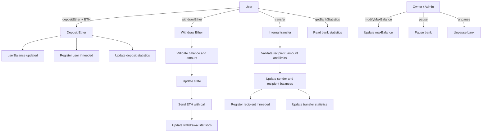

# <h1 align="center"> CryptoBank </h1>

This repository contains a Solidity project that implements a simple on-chain bank designed to practice more advanced smart contract fundamentals.

The contract allows users to deposit and withdraw Ether, transfer balances internally between registered users, and lets the owner manage administrative functions such as updating the maximum balance and pausing or unpausing the bank.

The main goal is to understand and practice the following Solidity concepts:

- State variables.
- Mappings and arrays.
- User registration.
- `payable` functions.
- Ether deposits and withdrawals.
- Internal transfers between users.
- Owner-only functions.
- Modifiers.
- Pause / unpause logic.
- Events.
- Contract statistics.
- Basic access control.
- CEI pattern (`Checks`, `Effects`, `Interactions`).

The contract is implemented in [`CryptoBankCustom.sol`](./CryptoBankCustom.sol).


### System flow




## Main features

The contract supports the following operations:

- **Deposit Ether**: users can send Ether to the contract through `depositEther`.
- **Withdraw Ether**: users can withdraw part of their stored balance through `withdrawEther`.
- **Modify max balance**: the owner can update the maximum balance allowed per user.
- **Pause / unpause**: the owner can temporarily stop user operations in case of incidents.
- **User registration**: users are registered automatically when they interact with the bank for the first time.
- **Internal transfers**: users can transfer balance to other users inside the bank without sending Ether externally.
- **Bank statistics**: the contract exposes aggregate statistics through `getBankStatistics`.


## Access control and modifiers

The contract uses two main modifiers:

- `onlyOwner`: restricts administrative actions to the `admin`.
- `whenNotPaused`: blocks user operations while the bank is paused.

Administrative functions:

- `modifyMaxBalance`
- `pause`
- `unpause`

User operations protected by `whenNotPaused`:

- `depositEther`
- `withdrawEther`
- `transfer`


## User balances and registration

Each user balance is stored in:

```solidity
mapping(address => uint256) public userBalance;
```

User registration is tracked with:

```solidity
mapping(address => bool) public isRegistered;
```

The contract also stores registered users in an internal array in order to track the total number of users.

Registration is handled automatically by the internal function `registerUser`, which is called when a user deposits Ether or receives an internal transfer.


## Ether flow

The contract handles Ether in two ways:

- **Incoming Ether** through `depositEther`.
- **Outgoing Ether** through `withdrawEther`.

Withdrawals use the low-level `call` pattern:

```text
msg.sender.call{value: amount_}("")
```

The contract also follows the **CEI pattern** in `withdrawEther`:

1. **Checks**: validate amount and balance.
2. **Effects**: update internal state.
3. **Interactions**: send Ether to the caller.

This is useful for understanding safer withdrawal logic and the reasoning behind reentrancy-aware patterns.


## Events

The contract emits events to track important actions:

- `EtherDeposited`
- `EtherWithdrawn`
- `PausedEvent`
- `UnpausedEvent`
- `UserRegistered`
- `TransferCompleted`

These events make it easier to inspect contract activity from transaction logs.


## Bank statistics

The contract includes a view function to retrieve global bank information:

- Total amount deposited.
- Total amount withdrawn.
- Total registered users.
- Total internal transfers.

This data is exposed through:

- `getBankStatistics`


## Contract behavior summary

This project helps practice the full lifecycle of a more complete Solidity contract:

```text
User deposits ETH → balance stored → user registered → user withdraws or transfers → statistics updated
```

At the same time, the owner can manage the system by:

```text
Updating max balance → pausing operations → unpausing operations
```

This makes the project a good exercise for combining Ether management, internal accounting, access control, events and contract state administration in a single contract.
